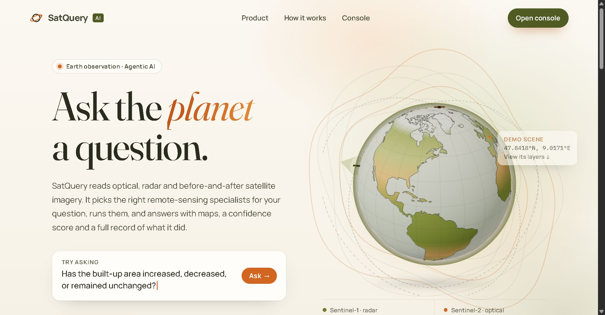
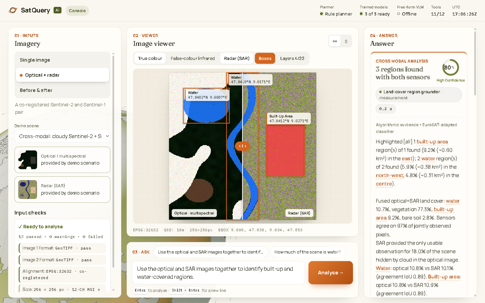

# SatQuery AI

**Ask a question about a satellite image in plain English, and get an answer with a map, a confidence
score and a record of how the answer was reached.**



You give SatQuery one or two satellite images and a question such as *"Is there water in this image?"* or
*"Has the built-up area grown since last year?"*. SatQuery works out which analysis tools the question
needs, runs them, checks their results against each other, and shows you:

- **the answer**, in a sentence;
- **where** it found it, highlighted on the image;
- **how sure** it is (high / medium / low confidence);
- **every step it took**, so you can check its work;
- a **report** you can download (PDF, web page or map file).

---

## What you can ask

SatQuery works with three kinds of input:

| You upload | Example questions |
|---|---|
| **One image** | "Is there a road in this image?" · "Is this a rural or an urban area?" · "Describe this scene." · "How much of the area is water?" |
| **An optical image + a radar image of the same place** | "Use both images to find the built-up and water areas." · "What does the radar see under the clouds?" |
| **Two images of the same place, taken at different dates** | "What changed between these dates, and where?" · "Has the built-up area increased, decreased or stayed the same?" |

No images of your own? The app comes with **demo scenes** you can try straight away.

> **Optical** images are normal photos from space, like Google Earth. **Radar** (SAR) images are made by a
> satellite that sends out microwaves; they see through clouds and work at night. More words in the
> [glossary](#glossary).

---

## Get started (about 10 minutes)

You need **Python 3.10 or newer**. Check with `python --version`. If it's missing, install it from
[python.org](https://www.python.org/downloads/); on Windows, tick **"Add Python to PATH"** in the installer.
You don't need a graphics card.

**1. Download the project**

```bash
git clone https://github.com/Vansh-Vaid/SatQuery.git
cd SatQuery
```

No git? On the GitHub page, click **Code → Download ZIP**, unzip it, and open a terminal in that folder.

**2. Install what it needs** (one time, a few minutes)

```bash
python -m venv .venv
```

Then switch the terminal to that environment:

- Windows: `.venv\Scripts\activate`
- macOS / Linux: `source .venv/bin/activate`

and install:

```bash
pip install -r requirements.txt
```

**3. Start it**

```bash
python run.py
```

Your browser opens at **http://localhost:8000**. Click **Open console**, pick a demo scene, and press
**Analyse**. Press `Ctrl + C` in the terminal to stop the app.

### Optional: add the trained AI models (one time, about 45-60 minutes)

The app works straight away using its measurement tools. For much better answers, add the three AI models
trained for satellite images: one recognises land types, one answers questions about a single image, and
one answers questions about change between two images.

```bash
python run.py --setup-models
```

This downloads three public datasets and trains the models on your own computer. A normal laptop is
enough. It keeps about 1 GB on disk, but the change dataset is streamed from a copy that bundles the
images with every question, so expect about 17 GB of download traffic. If it stops part-way, run the
same command again; it picks up where it left off.

For **sharp aerial photos** (objects such as planes, ships and vehicles), there is one more optional step.
It downloads about 12 GB, so it is kept separate:

```bash
python run.py --setup-highres
```

---

## Using the app



The console has four panels, numbered in the order you use them:

1. **Inputs** (left): choose *Single image*, *Optical + radar* or *Before & after*. Then pick a demo
   scene or drop in your own image files (GeoTIFF, `.tif`). SatQuery checks your files straight away and
   warns you if something is off, for example two images that don't cover the same place.
2. **Viewer** (middle): your images. Switch between true colour, infrared and radar views, and drag the
   slider to compare two images.
3. **Ask** (middle, below): type a question or click one of the suggestions, then press **Analyse**.
4. **Answer** (right): the answer and its confidence. Hover a highlighted word to see where it is on the
   image. Click **Show audit log** for the technical details, and scroll down for the step-by-step trace.

Below the answer, click **Download report bundle** for everything in one ZIP, or pick a single format
(PDF, Markdown, HTML, GeoJSON map file, or the JSON trace).

---

## How it works

```
 your images + your question
            │
            ▼
   1. Check the inputs ......... right file type? same place? dates in order?
            │
            ▼
   2. Plan ..................... which tools does this question need, in what order?
            │
            ▼
   3. Run the tools ............ AI models + measurement tools (water, vegetation, buildings, change...)
            │
            ▼
   4. Cross-check .............. do the tools agree? agreement raises confidence, disagreement lowers it
            │
            ▼
 answer + map + confidence + full record of every step
```

SatQuery is **agentic**: it decides for itself which tools to use for each question. It only picks from a
fixed list of approved tools, and only within safe settings, so its behaviour stays predictable and every
step is recorded.

If you have an Anthropic API key, Claude does the planning. Without one, built-in rules plan instead; both
are checked by the same safety validator.

---

## How accurate is it?

Everything below was measured on test data the models never saw during training.

| What was tested | Result |
|---|---|
| Recognising the type of land (forest, river, industrial, ...) in 5,399 test images | **95.7%** correct |
| The same, on 100 raw satellite files loaded the way a user upload is | **93%** correct |
| Answering questions about satellite images (RSVQA benchmark, 10,004 questions) | **84.6%** correct |
| – "Is there a ...?" questions | 90.7% |
| – "Are there more X than Y?" questions | 89.2% |
| – "Is this rural or urban?" | 88.0% |
| – "How many ...?" (answered as a range, e.g. *between 11 and 100*) | 72.0% |

| Answering questions about **what changed** between two real aerial images (CDVQA benchmark, 6,000 questions) | **65.1%** correct |
| – "Did X change / increase / decrease?" | 69–79% |
| – "What did X change into?" | 55.0% |
| – "What percentage changed?" (in 10% ranges) | 32.0% |
| Answering questions about **sharp aerial photos** (objects such as planes, ships, vehicles; VRSBench, 37,409 questions) | **54.0%** correct |
| – "Is there a ...?" | 87.5% |
| – "Where is the ...?" (top-left, bottom-right, ...) | 37.1% |
| Drawing a box around a described object in a sharp aerial photo (VRSBench, 16,159 descriptions) | **14.5%** correct |

Before the trained models were added, the single-image test scored 41.8%, the change test 18.7% and the
sharp-photo test 23.8%, about as good as guessing. Object boxes were never found at all (0%). For comparison, the research team that created the change benchmark reported 67.7%
with their own model.

## What it can't do yet

Being honest about the limits:

- **Free-form questions** ("what is next to the lake?") are answered weakly. That needs a larger
  vision-language model, which has to be trained on a graphics card (the training code is included).
- **Captions** are short sentences built from the models' own answers about the image (setting, main
  object, how many, where) plus the measured land cover. They are not written freely.
- **Object boxes** in sharp aerial photos are approximate: right about 1 time in 7, mostly for large
  objects such as sports fields and airplanes, rarely for small vehicles. The app always shows them with
  low confidence.
- **Change questions** are right about two times in three on real image pairs (65%, see above). The
  hardest are "what percentage changed?" and "what is the smallest change?".
- **Optical + radar analysis** has been tested on simulated images with known answers, not yet on real
  image pairs.
- Confidence scores are rule-based estimates, not calibrated probabilities.

---

## Troubleshooting

| Problem | Fix |
|---|---|
| `python` is not recognised | Install Python from python.org and tick "Add Python to PATH", then open a new terminal. On macOS/Linux, try `python3`. |
| `pip install` fails on **rasterio** | Upgrade pip first: `python -m pip install --upgrade pip`, then try again. |
| "Some packages are missing" | You may be outside the virtual environment. Run the activate command from step 2 again. |
| Port 8000 is already in use | Nothing to do: SatQuery picks the next free port and prints the address. Or choose one: `python run.py --port 8080`. |
| The browser didn't open | Open the address printed in the terminal (usually http://localhost:8000) yourself. |
| "The trained AI models are not installed yet" | That's a note, not an error. The app works; run `python run.py --setup-models` for better answers. |
| My image is rejected | SatQuery reads GeoTIFF files (`.tif`) with location information. For two images, they must cover the same area. The Inputs panel explains what is wrong. |

To check everything is working, run the automated tests: `python run.py --test`.

---

## Glossary

| Term | Meaning |
|---|---|
| **Optical image** | A picture taken in visible light (and sometimes infrared), like a photo. Clouds block it. |
| **Multispectral** | An optical image with extra colour bands beyond red, green and blue, such as infrared, which shows plant health. |
| **Radar / SAR** | Synthetic Aperture Radar. The satellite sends microwaves and measures the echo. It sees through clouds and works at night. |
| **Sentinel-1 / Sentinel-2** | Free European satellites: Sentinel-1 takes radar images, Sentinel-2 takes optical images. |
| **Bi-temporal** | Two images of the same place taken at different dates, used to find what changed. |
| **GeoTIFF** | An image file that also stores where on Earth it is. |
| **VQA** | Visual Question Answering: answering a question about an image. |
| **Confidence** | How sure SatQuery is about an answer, based on how strong and how consistent the evidence is. |

---

## For developers

- **[Technical reference](docs/TECHNICAL.md):** architecture, the tool list, configuration, training,
  evaluation commands and the full results.
- **[Design decisions](docs/DECISIONS.md):** what was chosen, what the alternatives were, and why.

| Folder | What's inside |
|---|---|
| `satquery/` | The application: input checks, planner, tools, web server |
| `frontend/` | Source code of the web interface (React). A ready-built copy is already included. |
| `training/` | Scripts that train the AI models |
| `eval/` | Scripts that measure accuracy on benchmarks |
| `tests/` | Automated tests |
| `demo_data/` | The demo scenes |

Handy commands:

```bash
python run.py                  # start the app
python run.py --setup-models   # download data and train the AI models
python run.py --test           # run the tests
python run.py --help           # all options
```
