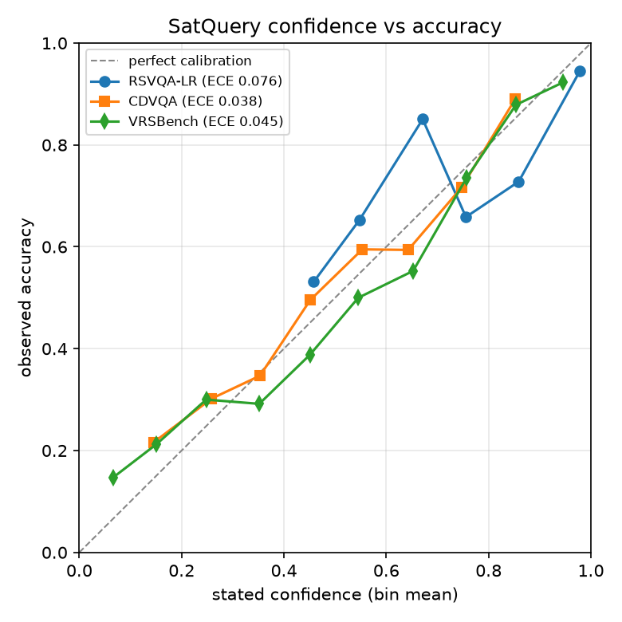

# SatQuery AI: technical reference

> New here? Start with the [beginner README](../README.md). This page is the full technical detail.

**An agentic vision-language assistant for multimodal remote-sensing image analysis through text queries.**

Upload one image (optical / multispectral / SAR), a co-registered **optical + SAR pair**, or a **bi-temporal
pair**, ask a question in plain English, and SatQuery:

1. validates the inputs (count, format, modality, metadata, grid / CRS / footprint compatibility, dates),
2. interprets the query and classifies the task,
3. selects and sequences specialist models/tools from a predefined registry (Claude planner or rule planner),
4. sets only permitted, bounded parameters and executes the workflow,
5. integrates textual and spatial outputs, cross-checks sources, estimates confidence, renders visual evidence,
6. returns an auditable execution trace and a downloadable report.

---

## Requirement coverage

| Problem-statement requirement | Implementation |
|---|---|
| RS adaptation of a visual component (BigEarthNet.txt **or open-source data**) | **Running now, trained on CPU:** ResNet-18 fine-tuned on EuroSAT Sentinel-2 (`rs_scene_classifier`, 95.7% test accuracy) and an RSVQA-LR VQA specialist built on it (`rsvqa_vqa`, 84.6% test accuracy). **GPU path, not yet run:** LoRA on Qwen3-VL-2B with BigEarthNet.txt (`training/finetune_vlm.py` → `rs_vlm`) |
| Single-image VQA (mandatory) | `rsvqa_vqa` (trained: presence, comparison, count, rural/urban), `rs_scene_classifier` (land-use questions), `landcover_reasoner` (measured cross-check), `rs_vlm` when a VLM is configured (free-form) |
| + captioning **or** grounding | **Both**: `rs_vlm` captioning and box grounding; `region_grounder` mask + box grounding (works without the VLM); VLM boxes are verified against land-cover evidence |
| Change description / change-VQA on a bi-temporal pair | `change_detector` (normalised CVA / SAR log-ratio / optional learned Siamese U-Net) → `change_semantics` (from→to transitions) → `change_qa` (yes/no, increase/decrease/unchanged, ratio, largest change, "what did X become", where, description) + `cdvqa_vqa` (trained on CDVQA; primary for change questions on optical pairs, cross-checked by `change_qa`); change map + magnitude heatmap |
| Optical–SAR complementary extraction | `landcover_optical` + `landcover_sar` → `optical_sar_fusion` (class-weighted decision fusion, SAR fills cloud gaps, per-class cross-sensor agreement, disagreement map); `rs_vlm` reads both images jointly. **Tested on 6 real Sentinel-2 + Sentinel-1 pairs:** 79.9% pixel accuracy fused vs 60.9% optical / 74.0% SAR (`eval/real_pair_test.py`) |
| Agentic orchestration | `satquery/agent/`: planner (Claude `claude-opus-5-5` with structured JSON limited to the registry, or rules) → `validate_plan` (unknown/incompatible/unavailable tools dropped, dependencies auto-inserted, undeclared params rejected, values clipped) → executor → integrator |
| Input checking | `satquery/imagery/validate.py`: per-check pass/warn/fail, chronological reordering, reprojection to a common grid, footprint IoU, joint valid-pixel coverage |
| Formats | GeoTIFF/TIFF (any band count, uint8/uint16/float, linear or dB SAR); PNG/JPEG accepted for benchmark images with an explicit warning |
| Visual evidence, confidence, execution summary, downloadable reports | Web UI gallery (masks, heatmaps, boxes), confidence score + label (see D7; measured ECE 0.04-0.08 on three benchmarks), step-by-step trace (tool, params, status, timing, output), HTML report with embedded images + JSON trace |
| Interactive GUI | FastAPI + web UI (`satquery/web/`), demo scenarios built in |
| Test & demo scripts | `tests/` (59 tests), `scripts/smoke_vlm_pipeline.py`, `scripts/run_query.py`, `demo_data/` |
| Evaluation on VRSBench, RSVQA, CDVQA (+ BigEarthNet.txt bench) | `eval/convert.py` (dataset → common JSONL) + `eval/run_eval.py` (agent or VLM-only; accuracy per question type, BLEU/ROUGE-L/CIDEr, mIoU / Acc@0.5) |

## Architecture

```
            ┌──────────── Web UI / REST API / CLI ────────────┐
 query  ──► │                                                 │ ──► answer · confidence · visual evidence
 images ──► │  1 Input validation  (imagery/validate.py)      │     execution trace · HTML/JSON report
            │  2 Planner  Claude (structured JSON) | rules    │
            │  3 Plan validator  ── tool registry (9 tools) ──┤
            │  4 Executor  (shared upstream outputs)          │
            │  5 Integrator  cross-checks · confidence        │
            └──────────────────────────────────────────────────┘
   Registry ─┬─ rs_vlm ............. Qwen3-VL-2B + LoRA(BigEarthNet.txt)   learned, RS-adapted
             ├─ landcover_optical .. NDVI / MNDWI / NDBI / BSI + cloud      algorithmic
             ├─ landcover_sar ...... Lee filter, Otsu water, double-bounce  algorithmic
             ├─ optical_sar_fusion . class-weighted fusion, cloud gap-fill  algorithmic
             ├─ region_grounder .... referring-expression → regions/boxes   algorithmic
             ├─ landcover_reasoner . evidence-based VQA / description       reasoning
             ├─ change_detector .... CVA / log-ratio / Siamese U-Net        algorithmic / learned
             ├─ change_semantics ... land-cover transitions in change mask  algorithmic
             └─ change_qa .......... change-VQA + change description        reasoning
```

Why both learned and algorithmic specialists: the adapted VLM gives free-form language understanding;
the physically based tools give pixel-accurate, quantitative, auditable evidence (areas, maps, cloud
gap-filling) and keep the system useful when the GPU model is offline. The integrator uses one to check
the other (e.g. VLM yes/no vs. measured class fraction; VLM boxes vs. land-cover masks) and lowers
confidence on disagreement. See `docs/DECISIONS.md`.

## Quickstart

```bash
pip install -r requirements.txt
python run.py                        # or: uvicorn satquery.api.app:app --port 8000
# http://localhost:8000          landing page (3D globe, live layer stack, live evidence)
# http://localhost:8000/console  analysis console → pick a mode / demo scenario → EXECUTE
```

Both pages share one visual system: off-white paper, olive-black text, a burnt-orange accent and olive
secondary colours, set in Fraunces (headlines), Manrope (interface) and IBM Plex Mono (data values).

The landing page is a short front door, about two screens on desktop:
- a draggable 3D atlas globe with Sentinel-1/2 orbits and a "Try asking" prompt;
- a ticker of example questions;
- an interactive 3D stack of the real analysis layers for each input type;
- three "how it works" steps, each showing a live fact from a demo run.

All of its imagery is live output from the running backend. If the backend is unreachable, the page labels
the illustrative fallbacks as such. Every link opens the console with the scene and question prefilled
(`/console?mode=…&demo=…&q=…`).

The built UI ships in `satquery/web/dist`. To change it:

```bash
cd frontend && npm install
npm run dev        # hot-reload on :5173, proxies /api to :8000
npm run build      # type-check + build into satquery/web/dist
```

### Console (`/console`)

A three-column workspace in React + TypeScript + Three.js (react-three-fiber):

- **Backdrop:** a light atlas globe that rotates and zooms to the loaded GeoTIFF's WGS84 footprint and
  outlines it in orange. It renders on demand, only while moving.
- **01 Inputs:** three modes (single image, optical + radar, before & after), drop slots, demo scenes, and
  live input checks from `/api/inspect` (format, alignment, size and bands, dates).
- **02 Viewer:**
  - a split-swipe curtain (optical ↔ radar, before ↔ after; vertical or horizontal; keyboard accessible);
  - a layer bar for true colour, false-colour infrared, radar, boxes, change masks and every tool layer;
  - boxes with lat/lon callouts, and a crosshair showing pixel and approximate lat/lon.
- **03 Ask:** a question box with example-question chips (Enter to run).
- **04 Answer:**
  - an answer card whose highlighted words draw beams to their regions on the image;
  - a flip side with the audit log (model, adaptation source, input shapes, latency, parameters, regions);
  - the execution trace as a directed graph: task, input checks, validator corrections, each tool with its
    status, latency, confidence and parameters, then the result.
- **Export:** a ZIP bundle (PDF, Markdown, HTML, GeoJSON in WGS84, JSON trace), or each format separately.
- **Responsive and accessible:** single column below 900 px, and `prefers-reduced-motion` stops
  decorative motion.

Performance:
- Both pages hold 60 fps in Chrome, measured with a rAF frame counter on the development machine.
- An analysis request takes about 0.3 s warm. Report images are rendered only when a report is downloaded,
  which keeps the API response under 1 MB.

CLI:

```bash
python scripts/run_query.py "What changed between these two dates, and where did the change occur?" \
    demo_data/s2_2024-06-01.tif demo_data/s2_2025-06-05.tif --report out/report.html
```

Tests: `python -m pytest -q` (CPU, ~30 s). VLM plumbing smoke test (tiny random Qwen3-VL, CPU, ~1 min):
`pip install -r requirements-train.txt && python scripts/smoke_vlm_pipeline.py`.

### Configuration (environment variables)

| Variable | Default | Meaning |
|---|---|---|
| `SATQUERY_PLANNER` | `auto` | `auto` (Claude if credentials resolve, else rules), `llm`, `rules` |
| `SATQUERY_PLANNER_MODEL` / `_EFFORT` | `claude-opus-5-5` / `low` | Claude planner model and effort |
| `ANTHROPIC_API_KEY` | – | Claude credentials (or an `ant auth login` profile) |
| `SATQUERY_VLM_BACKEND` | `off` | `hf` (local transformers), `remote` (GPU server), `off` |
| `SATQUERY_VLM_BASE` | `Qwen/Qwen3-VL-2B-Instruct` | base VLM |
| `SATQUERY_VLM_ADAPTER` | – | path / HF id of the BigEarthNet.txt LoRA adapter |
| `SATQUERY_VLM_ENDPOINT` | – | URL of `scripts/serve_vlm.py` when backend is `remote` |
| `SATQUERY_CHANGE_CKPT` | – | Siamese U-Net checkpoint (enables learned change detection) |
| `SATQUERY_RATE_LIMIT` | `0` (image: `20`) | analyses + input checks per client IP per minute; `0` = unlimited |
| `SATQUERY_MAX_CONCURRENT` | `2` | analyses running at once; others wait up to `SATQUERY_QUEUE_TIMEOUT` |
| `SATQUERY_QUEUE_TIMEOUT` | `60` | seconds a request waits for a free slot before a 503 "busy" |
| `SATQUERY_MAX_UPLOAD_MB` | `200` (image: `100`) | per image; enforced while streaming, plus a body-size check |
| `SATQUERY_MAX_QUERY_CHARS` | `1000` | longest accepted question |
| `SATQUERY_PERSIST_RUNS` | `1` (image: `0`) | write each run's trace to `SATQUERY_RUN_DIR` |
| `SATQUERY_WARM_UP` | `1` | load the models and pre-compute the landing demos at startup |
| `PORT` / `FORWARDED_ALLOW_IPS` | `7860` / `*` | Docker image only: listen port; proxies trusted for client IPs |

### Deployment

`Dockerfile` builds a CPU image: CPU-only PyTorch, the ImageNet weights fetched at build time, and the
trained checkpoints baked in from `checkpoints/`. It runs one uvicorn process as a non-root user (uid 1000),
with a health check on `/api/health`. Measured locally in production mode:
- warm-up takes 9.9 s;
- a cached landing demo answers in 0.06 s;
- an uploaded analysis takes about 0.3 s;
- memory is 615 MB after warm-up.

Deploy routes:
- **Live demo:** GitHub Actions (`.github/workflows/build-image.yml`) builds the image on every push to
  `main`. It pulls the checkpoints from the `models-v1` release and publishes
  `ghcr.io/vansh-vaid/satquery:{latest,<sha>}`, a public package. Then `python scripts/deploy_azure.py`
  creates or updates an Azure Container App with 1 vCPU / 2 GiB and 0-1 replicas (scales to zero) in
  `koreacentral`.
  - The script deploys the `<sha>` tag of the newest successful build, because Azure keeps a cached copy
    of `:latest`.
  - It forces a new revision through an env var, because express environments reject revision suffixes.
  - Measured on the live app: demo analyses answer in about 1.5 s.
- Any Docker host: `docker run -p 8000:7860 ghcr.io/vansh-vaid/satquery:latest`. Hugging Face Spaces was
  the first plan, but Docker Spaces now need HF PRO (the free tier returns 402), so that route was dropped.

The build runs `import rasterio, cv2, torch, ...` so that a missing system library fails the build, not
the live app. The first live deploy failed this way: the `python:*-slim` images no longer ship `libexpat1`,
which the rasterio wheel's GDAL needs.

One process is deliberate: the rate limiter, the demo cache and the report store are in memory. To scale
out, move them to Redis and run several replicas behind a load balancer.

The Claude planner uses structured outputs (JSON schema whose tool enum *is* the registry), server-side
refusal fallbacks (`fallbacks: "default"`), prompt caching of the registry prompt, and falls back to the
rule planner on any API error. Either way, every plan passes `validate_plan` before execution.

## Remote-sensing adaptation (training)

The machine this was built on has no GPU, so training runs on Kaggle/Colab/a rented GPU:

1. **Data.** `BigEarthNet.txt.parquet` (464k S1/S2 pairs, 9.6M annotations; HF
   `BIFOLD-BigEarthNetv2-0/BigEarthNet.txt`, CDLA-Permissive-1.0) + BigEarthNet v2.0 imagery
   (GeoTIFF folders or rico-hdl LMDB).
   ```bash
   python training/prepare_bigearthnet_txt.py --s2-root BigEarthNet-S2 --s1-root BigEarthNet-S1 \
       --out data/bentxt --per-type 6000 --splits train validation bench
   ```
   Images are rendered with the same code as inference (`satquery/models/vlm_prompts.py`); 30% of
   samples are S2-only so the model works on single images; the rest present S2 + S1 together.
2. **LoRA fine-tune** (Qwen3-VL-2B, r=16, language-model attention + MLP, frozen vision encoder,
   answer-only loss; ~3-4 h on an L4 for 24k samples):
   ```bash
   python training/finetune_vlm.py --data data/bentxt --out checkpoints/satquery-vlm-lora --epochs 1
   ```
3. **Serve.** Local: `SATQUERY_VLM_BACKEND=hf SATQUERY_VLM_ADAPTER=checkpoints/satquery-vlm-lora`.
   Remote GPU: `python scripts/serve_vlm.py --adapter checkpoints/satquery-vlm-lora` and point
   `SATQUERY_VLM_ENDPOINT` at it.
4. **Optional learned change detector** on LEVIR-CD: `python training/train_change.py --root LEVIR-CD
   --out checkpoints/change_unet.pt`.

Reference point: the BigEarthNet.txt paper's own LoRA fine-tune of InternVL3-1B reports large gains
over zero-shot VLMs on its benchmark (binary VQA ~73% vs ~62%, referring mIoU ~66 vs ~32).

## Evaluation

```bash
python eval/convert.py bentxt   --root data/bentxt --split bench --out eval/data/bentxt_bench.jsonl
python eval/convert.py rsvqa    --root RSVQA_LR --split test     --out eval/data/rsvqa_lr.jsonl
python eval/convert.py vrsbench --root VRSBench                  --out eval/data/vrsbench.jsonl
python eval/fetch_cdvqa.py --split test --shards 60       # CDVQA subset from its Hugging Face mirror
python eval/run_eval.py --data eval/data/rsvqa_lr.jsonl --mode agent --out eval/results/rsvqa
python eval/run_eval.py --data eval/data/bentxt_bench.jsonl --mode vlm --out eval/results/bench_lora
```

`--mode vlm` isolates the adapted model (run it once with and once without `SATQUERY_VLM_ADAPTER` to
measure the adaptation gain); `--mode agent` measures the full system.

**Measured results** (all on held-out test data; reproduce with the commands above and below):

| What | Data | Result |
|---|---|---|
| `rs_scene_classifier` (EuroSAT-adapted ResNet-18) | EuroSAT official test split, 5,399 images | **95.7%** accuracy |
| Same model on raw 13-band GeoTIFFs via SatQuery's loader and rendering | EuroSAT100, 100 real Sentinel-2 tiles | **93%** accuracy |
| `rsvqa_vqa` alone | RSVQA-LR official test split, 10,004 questions | **84.6%** overall; presence 90.7%, comparison 89.2%, rural/urban 88.0%, count 72.0% (5 bins) |
| Full agent (planner + tools + integration) | RSVQA-LR test, stratified 1,300-question sample | **85.7%** overall |
| Full agent before the trained specialist (rules only) | same sample | 41.8% (near chance) |
| Land-cover tool on real Sentinel-2 | EuroSAT100 | water 64% on sea/lake/river tiles vs 0.6% elsewhere; vegetation 100% on forest |
| `cdvqa_vqa` alone (change questions on real aerial pairs) | CDVQA test set 1, 6,000 questions over 208 pairs (60 of 397 shards, evenly spaced) | **65.1%** overall; change yes/no 78.9%, class change ratio 70.1%, decrease 70.4%, increase 69.2%, change-to-what 55.0%, largest 47.9%, change ratio 32.0%, smallest 22.4% |
| Answering each CDVQA question with its type's most common training answer | same 6,000 questions | 51.0% |
| Full agent on change questions (planner + `cdvqa_vqa` + `change_qa` cross-check) | CDVQA test, stratified 1,200-question sample (150 per type) | **55.7%** (equal weight per type; matches the specialist's average accuracy, so routing loses nothing) |
| Rule-based change tools only (before `cdvqa_vqa`) | same sample | 18.7% |
| `hr_vqa` alone (high-resolution aerial VQA) | VRSBench VQA eval set, all 37,409 questions, exact match after normalisation | **54.0%**; existence 87.5%, image 83.7%, rural/urban 78.3%, shape 54.0%, reasoning 50.4%, category 48.2%, colour 46.1%, direction 44.7%, scene type 44.3%, size 42.4%, quantity 39.1%, position 37.1% |
| Full agent on VRSBench VQA | stratified 600-question sample (50 per type) | **58.0%** (was 23.8% before `hr_vqa`) |
| `hr_grounder` (referring-expression boxes) | VRSBench referring eval set, 16,159 expressions | **14.5%** Acc@0.5, mean IoU 0.21; ground-track field 28.5%, tennis court 25.9%, airplane 23.8%, vehicle 0.7%. Full agent on a 250-expression sample: 14.8% (was 0%) |
| Captions on VRSBench | 150-image sample, full answer vs reference | BLEU-1 0.173, BLEU-4 0.038, ROUGE-L 0.136 (was 0.132 / 0.031 / 0.109) |
| Optical-SAR land cover on real pairs (`eval/real_pair_test.py`) | 6 sites × 6 km (Rotterdam, Geneva, Cairo, Hyderabad, Sacramento, Dhaka under 44% cloud); Sentinel-2 L2A + Sentinel-1 RTC 0-3 days apart, from Planetary Computer; ESA WorldCover 2021 as reference; per-pixel, 4 classes | mean pixel accuracy: `optical_sar_fusion` **79.9%**, `landcover_sar` 74.0%, `landcover_optical` 60.9%. Macro-F1 0.718 / 0.616 / 0.645. Mean IoU fused: water 0.73, built-up 0.72, vegetation 0.50, bare soil 0.03. Under cloud (Dhaka, ESA SCL mask): fused 77.7%, SAR 76.6%, optical 35.0%. Fusion beats both single sensors on 5 of 6 sites; on Cairo SAR alone is higher (84.2% vs 81.7%) |
| Confidence calibration (`eval/calibration_report.py`) | the full-agent runs above: RSVQA-LR 1,300, CDVQA 1,200, VRSBench VQA 589 questions | expected calibration error (ECE, 10 bins) **0.076 / 0.038 / 0.045**; mean confidence 85.8% vs accuracy 85.7%, 54.0% vs 55.7%, 60.2% vs 59.1%. Accuracy by label: high 89.7% / 87.5% / 88.4%, medium 78.2% / 59.8% / 57.3%, low 53.7% / 38.5% / 27.6%. Reliability diagram: `docs/images/calibration.png`. RSVQA-LR is underconfident around 0.6-0.7 and overconfident around 0.75-0.9 |
| Full agent on the same pairs | 1 cross-modal question per site | runs `landcover_optical → landcover_sar → optical_sar_fusion → region_grounder → landcover_reasoner`; status ok on 6/6; confidence "medium" on clear sites, "low" on Dhaka; about 3 s per question on a laptop CPU |

```bash
python training/train_scene_classifier.py --data data/eurosat        # ~18 min CPU
python training/train_rsvqa_lr.py --root data/rsvqa_lr              # ~3 min CPU
python eval/real_sentinel2_check.py --root data/eurosat/ms100
python eval/convert.py rsvqa --root data/rsvqa_lr --split test --out eval/data/rsvqa_lr_test.jsonl
python eval/run_eval.py --data eval/data/rsvqa_lr_test.jsonl --mode agent --out eval/results/rsvqa_lr
python eval/fetch_cdvqa.py --split train --shards 150       # ~514 pairs, 15k questions (resumable)
python eval/fetch_cdvqa.py --split test  --shards 60
python training/train_cdvqa.py                              # ~6 min CPU
python eval/convert.py vrsbench --root data/vrsbench --out eval/data/vrsbench_val.jsonl
python training/train_vrsbench_vqa.py --features-only       # encode images once (~15 min CPU, resumable)
python training/train_vrsbench_vqa.py --epochs 8            # ~8 min
python training/train_vrsbench_grounding.py --features-only # dense 14x14 maps (~1-1.5 h CPU, resumable)
python training/train_vrsbench_grounding.py                 # the 14.5% figure above is the earlier 3x3 model
python eval/calibration_report.py eval/results/rsvqa_lr eval/results/cdvqa_agent eval/results/vrs_agent_vqa --names RSVQA-LR CDVQA VRSBench --plot docs/images/calibration.png
```



VRSBench scoring here is strict exact match after normalisation; the VRSBench paper judges open answers with
GPT-4, so the numbers are not directly comparable to its leaderboard.

For reference, the original RSVQA-LR paper (Lobry et al., 2020) reported about 79% overall. Count protocols
may differ, so treat this as indicative.

CDVQA reference (Yuan et al., TGRS 2022, Table I, test set 1): 67.7% overall with a ResNet-18 trained end to
end on 1,600 pairs, and 69.0% for their best variant (ResNet-101 + change-enhancing module). `cdvqa_vqa`
reaches 65.1% with frozen EuroSAT features, trained on 437 pairs, scored on a 6,000-question subset of the
same test set. Per type it is within a few points of their ResNet-18 everywhere. The subset is not the full
test set, so compare with care.

Real optical-SAR pairs: `python eval/real_pair_test.py` (about 10 minutes, about 100 MB download, no
account). WorldCover is a 2021 map scored against 2023 images, and its "built-up" class covers whole city
blocks including street trees, so the absolute numbers are a lower bound. The comparison between optical,
SAR and fused on the same pixels is the meaningful result. The test found one real-data failure, now fixed
(D17): ESA's L2A correction over hazy Cairo pushed the Nile to near-zero visible/NIR reflectance, so MNDWI
went negative and optical water IoU was 0.01. A dark-pixel NDWI fallback raised it to 0.65.

**Not yet run:** the BigEarthNet.txt VLM fine-tune (Kaggle notebook ready, `kaggle/satquery_vlm.ipynb`).

## Repository layout

```
satquery/
  imagery/   raster model, GeoTIFF/PNG loading, modality inference, rendering, validation
  tools/     registry + 9 specialist tools (base.py = contract: specs, params, results)
  agent/     planner (Claude / rules), plan validator, controller (execute, integrate, trace)
  models/    VLM prompt/rendering contract, VLM backends (HF / remote), Siamese U-Net
  reports/   HTML/JSON reports + bundle (PDF, Markdown, GeoJSON, ZIP)
  api/       FastAPI backend (/api/inspect, /api/analyze, /api/report/*)
  web/dist/  built web UI (source in frontend/)
frontend/    React + TypeScript + Three.js HUD (Vite)
  demo/      synthetic S1/S2 scene generator + demo scenarios
training/    BigEarthNet.txt preparation, LoRA fine-tuning, change-detector training
eval/        benchmark converters, metrics, evaluation runner
scripts/     CLI, VLM GPU server, VLM pipeline smoke test
tests/       pytest suite
docs/        DECISIONS.md (design decisions and rationale)
```

## Known limitations

- Algorithmic land-cover tools use fixed physical thresholds; they are robust on Sentinel-1/2 but
  approximate on 8-bit RGB benchmark images (flagged with lower confidence in the output).
- Counting questions count land-cover *patches*, not objects; object-level counting relies on the VLM.
- The VLM's change reading is auxiliary (BigEarthNet.txt has no bi-temporal pairs); change answers are
  driven by the change specialists.
- The CDVQA mirror (`ljx620/CDVQA`) is unofficial; its test split matches the paper's test set 1 in size
  (about 39.7k questions). Answers are scored by `eval/metrics.canonical_cdvqa` (`0-10%` = `0_to_10`).
